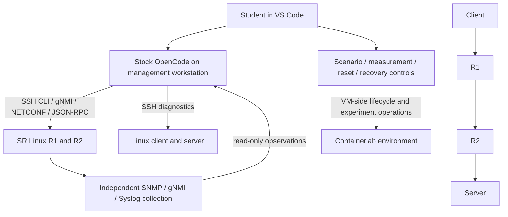

# Architecture and access

The lab is the scaffold. The stock agent works through normal device interfaces;
the student controls the scaffold separately.

One Ubuntu VM runs the reference network and a management workstation. Application
traffic uses client—R1—R2—server. A separate management network provides device
protocol access; successful management access does not prove application recovery.
The student can inspect all implementation and scenario code in this VM.

The management workstation uses an ordinary non-root `agent` account and a pinned,
unmodified OpenCode binary. It has standard native clients and a neutral device
inventory, with no prescribed incident, solution sequence, approval gateway,
custom model policy or lab tool/plugin. Students provide their own prompt and
model access. They may use other ordinary clients/tools in this environment.

A generated `netops` device identity permits general network configuration,
including interfaces, routing and ACLs, through native APIs. Native device roles
exclude account/authorization changes and router Linux/root/host-command access.
The agent cannot grant itself stronger credentials. A separate private provisioning
identity supports initialization and recovery. Independent collectors retain their
read-only identity. SSH host keys and the TLS CA are verified.

The workstation receives no Docker socket, Containerlab client, VM login, operator
workspace or scenario/recovery API. VM-owned network filters also cover traffic
originating at administrable routers, preventing access to VM control services and
private external networks. Required device protocols and telemetry remain usable.
This is a local student sandbox, not a guarantee against every device/container
exploit. Native access can still break the experiment or disconnect the agent.

Student controls are separate: scenarios, workload pause/resume, factual telemetry,
application checks, baseline reset, out-of-band device recovery and fresh trials.
The internal privileged helper implements only experiment operations; it does not
proxy agent configuration writes or determine whether an agent's answer is correct.

Reset preserves the home/history. Recovery rebuilds device containers and trust
out of band while preserving that home. Fresh trial archives/verifies the home
before replacing it. Normal open/start resumes existing devices; reboot persistence
follows saved router startup configuration. There is no automatic reset on open.

`~/.config/network/` holds generated native client configuration and credentials;
`~/.ssh/` holds generated device SSH identity/trust. Both remain private runtime
state. Collected observations are mounted read-only at `~/observations`.
No host/provider/device keys or runtime profiles belong in this repository.
